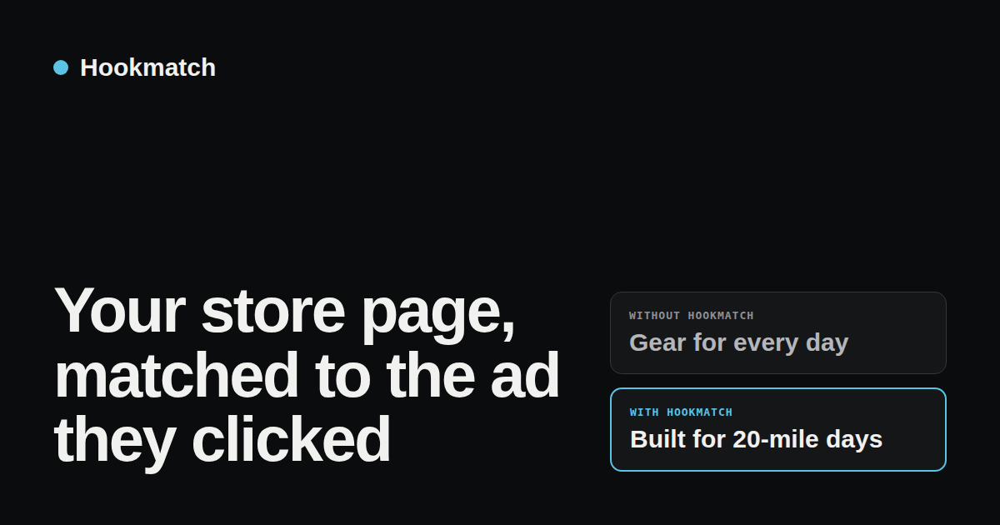

# Hookmatch

**Show every Meta ad click a store page that matches the ad.**

Hookmatch is a Shopify app. When a shopper clicks a Facebook or Instagram ad, it changes the headline, hero image or video, badge and offer on your store to match the idea that ad sold, or sends them to a page you already built for it. It then reports orders and revenue per angle and per ad, with a built-in holdout so you can see whether the match actually lifted sales.

<p align="center"></p>

## Why we built it

The most common complaint from people who run Meta ads to a Shopify store is "clicks but no sales." Usually the ad sold one specific idea (for example, "keep your fridge running in a blackout") and the page it landed on was the generic store. The shopper has to work out whether this is the thing they clicked.

The usual fixes are all painful:

- Duplicate the product page once per audience and lose track of which copy converts.
- Build a page per angle in a page builder, then keep the links straight by hand.
- Buy a personalization app that keys off UTM campaign names you typed in yourself, swaps a banner, and tells you nothing about revenue per ad.

We looked at what is out there (see [docs/MARKET.md](docs/MARKET.md)). Apps in this space match on UTM text or hand-built links. None of the ones we found use the Meta ad ID, none discover your ads on their own, and none show revenue per ad with a control group. Hookmatch does those three things and leaves nothing behind in your theme code.

## What it does

**Matching.** Paste one URL-parameters string into Meta Ads Manager (once, at ad level). It carries the ad, ad set and campaign IDs and names. Hookmatch matches in this order and the first hit wins:

1. `hm_angle=<slug>` in the link (for any channel, not just Meta)
2. Ad ID
3. Ad set ID
4. Campaign ID
5. A word contained in the ad, ad set or campaign name

No Meta login or Ads API access is needed. Ads show up in the app by themselves the first time they send a click, and you assign each one to an angle in one click.

**An angle** is one audience or idea. You give it a name, an ICP note, match rules, and what to change:

- headline and subheadline
- hero image or video (picked from Shopify Files)
- a badge
- an optional route (send the visitor to a page you already built)
- an optional discount code, applied automatically for that visitor

**Swapping.** In Auto mode the app embed changes your theme's own hero in place: the first `h1` (or the first section's `h2`), the paragraph after it, and the largest image or video in that section. The element keeps its classes and size, so the layout does not move. Optional app blocks (Matched headline, subheadline, media, badge) cover places Auto does not reach. If a theme's hero is unusual, CSS selector fields let you point at the right elements. Header, footer, navigation and cart drawers are never touched.

**No flicker.** A small inline snippet hides only the targets while a match is pending, for at most 1.2 seconds, and the page reveals once the new image has decoded.

**Measurement.** Every matched visitor is tagged on the cart (`_hm_angle`, `_hm_arm`, `_hm_ad`), and the `orders/create` webhook turns that into attributed revenue. The Report page shows, per angle and per ad: sessions, orders, revenue, conversion rate, revenue per visit, and matched versus control with lift. A share of matched visitors (you pick the percent, Pro plan) get your normal store instead, so the lift is measured, not assumed. The report does not show a lift number until there are enough sessions behind it.

**Light and clean.** The storefront script is about 3.2 KB gzipped. In our Lighthouse runs it cost about one point, with no layout shift. Matching reads config that is printed into the page, so there is no extra network call before the page can change. Uninstalling removes the blocks and leaves nothing in the theme.

## What we have and have not measured

Tested end to end on Shopify development stores and on one real store that was still behind its storefront password: matching, swap, route, discount, hit logging, order attribution and the report with its control group. The repo has 105 unit tests and 77 storefront browser tests.

Early pilots on live stores running Meta ads have been encouraging, with ROAS up sharply in the first tests. Those are early, small, operator-reported numbers and we have not published a detailed breakdown yet. Results depend on the store and the ads, so the holdout exists to let you measure the lift on your own store.

## How it is built

- Shopify's React Router app template, embedded admin with App Bridge and Polaris web components
- Prisma on Postgres (daily hit counts, ads seen, order attribution)
- Theme app extension: an app embed in `head` plus four blocks, and `hm.js`
- App proxy (`/apps/hm/hit`) for the visit beacon, signature verified
- Config in app-owned shop metafields: an admin copy only the app reads, and a public copy that contains only active angles (no ICP notes, no names)
- Shopify managed pricing: Free (1 active angle, full reporting) and Pro (unlimited angles and holdout)

The full product spec is in [docs/SPEC.md](docs/SPEC.md).

## Run it yourself

You need Node 22.12 or newer, a Shopify Partner or Dev Dashboard account, a development store, and a Postgres database.

```bash
npm ci
cp .env.example .env        # fill it in
npx shopify app config link # creates or links your app, fills client_id
npm run dev                 # tunnel, install on your dev store
```

Then in your dev store:

1. Open the theme editor and turn on the **Hookmatch** app embed.
2. In the app, create an angle and give it a slug.
3. Visit `https://<store>/?hm_angle=<slug>`. The hero changes. Plain `/` does not.
4. For Meta, copy the URL parameters string from Settings into your ads.

Update the URLs in `shopify.app.toml` and the support and privacy pages (`app/routes/privacy.tsx`, `app/routes/support.tsx`) to your own before you ship an app from this code.

Checks:

```bash
npm test                 # unit tests
npm run test:storefront  # browser tests for hm.js
npm run check:theme      # theme extension lint
npm run typecheck
```

Set `HOOKMATCH_PRO_SHOPS` to a comma-separated list of your own myshopify domains to unlock Pro on them without billing.

## Known limits

- Auto mode runs on the landing hit and the home page only, so a matched visitor's collection, cart and article titles keep their own text.
- Product-page landings from an ad can replace the product title; use blocks or selectors if you do not want that.
- Hero images are cropped to the theme's hero box, so use images framed for it.
- Meta only. No Ads API, no AI-written angles, no page builder (route to Replo, GemPages or any page you have).
- Revenue is gross order totals, shown in the shop currency.

## License

MIT. Built on Shopify's app template, which is MIT too.
